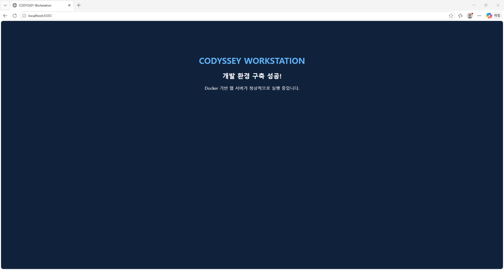
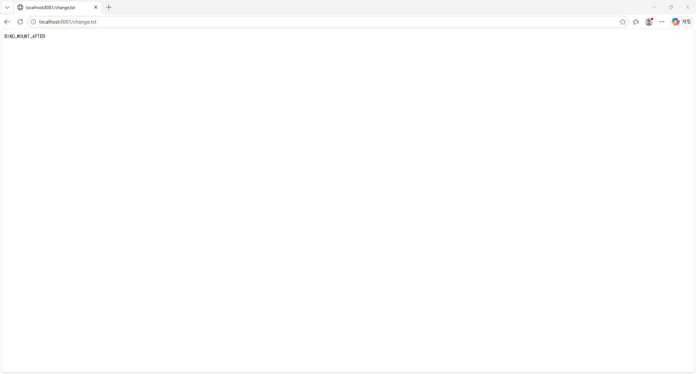

# CODYSSEY MISSION 01 — 개발 워크스테이션 구축

> **입학연수 · 개발 입문 · 필수 40시간**  
> 터미널, Docker, Git/GitHub를 이용해 재현 가능한 개발환경을 만들고 실행 결과로 검증하는 미션

## 1. 프로젝트 개요

Windows의 WSL 2에서 Ubuntu와 VS Code를 연동하고, Linux CLI로 파일·권한을 관리했습니다. Docker Desktop 환경에서 `hello-world` 및 Ubuntu 컨테이너를 실행·관리했고, NGINX 기반의 자체 `Dockerfile`로 정적 웹 서버 이미지를 빌드했습니다. 로컬 포트로 웹 서버에 접속하고, 바인드 마운트의 변경 반영과 Docker 볼륨의 데이터 영속성을 확인했습니다.

- **제출 형식:** 이 GitHub 저장소의 소스코드, README, 실제 실행 로그 및 스크린샷
- **실습 위치:** Ubuntu 홈 디렉터리의 `codyssey-workstation` (개인 컴퓨터 경로에 따라 달라짐)
- **웹 서버 이미지:** `codyssey-web:1.0`
- **기본 접속 포트:** 호스트 `8080` → 컨테이너 `80`
- **바인드 마운트 검증 포트:** 호스트 `8081` → 컨테이너 `80`

## 2. 실행 환경

| 구성요소 | 실습에서 확인한 값 | 확인 근거 |
| --- | --- | --- |
| 호스트 환경 | Windows + WSL 2 | [Docker 상태 로그](evidence/logs/02_docker_basics.log) |
| Ubuntu (WSL) | Ubuntu **26.04.1 LTS** | `cat /etc/os-release` 실습 출력 (README 작성 전 별도 확인) |
| 셸 / 터미널 | Bash / VS Code 통합 터미널 (WSL: Ubuntu) | [Linux CLI 로그](evidence/logs/01_terminal.log) |
| Docker Desktop | **4.97.0** | [Docker 상태 로그](evidence/logs/02_docker_basics.log) |
| Docker Client / Server | **29.9.2** | [Docker 상태 로그](evidence/logs/02_docker_basics.log) |
| Docker Compose | **v5.6.1** (설치 확인, 보너스 수행은 별도) | [Docker 상태 로그](evidence/logs/02_docker_basics.log) |
| Git | **2.53.0** | 사용자 터미널에서 `git --version`으로 확인 |
| 실습용 Ubuntu 컨테이너 | Ubuntu **24.04.5 LTS** (`ubuntu:24.04`) | [Docker 기본 실습 로그](evidence/logs/02_docker_basics.log) |

> **주의:** WSL의 Ubuntu 버전(26.04.1)과 컨테이너 안의 Ubuntu 버전(24.04.5)은 서로 다릅니다. 이는 정상이며, 서로 다른 실행 환경임을 보여줍니다. Windows의 정확한 에디션·빌드 정보는 아직 확인하지 않았으므로 기재하지 않았습니다.

## 3. 필수 수행 체크리스트

- [x] 현재 경로·숨김 파일 목록·디렉터리 이동·파일 생성/복사/이름 변경/삭제/내용 확인
- [x] 파일 권한 변경 `644 → 600`, 디렉터리 권한 변경 `755 → 700`
- [x] `docker --version`, `docker info`로 설치 및 엔진 점검
- [x] `hello-world` 및 Ubuntu 컨테이너 실행
- [x] `docker images`, `docker ps`, `docker ps -a`, `docker logs`, `docker stats` 실행
- [x] 컨테이너 중지/재시작 및 `attach` 방식(`start -ai`)과 `exec` 방식 확인
- [x] 직접 작성한 NGINX 기반 Dockerfile로 커스텀 이미지 빌드
- [x] 포트 매핑 및 HTTP 접속 확인 (8080)
- [x] 바인드 마운트 수정 전후 확인 (8081)
- [x] Docker 볼륨을 컨테이너에 연결하고 삭제 후 데이터 유지 검증
- [x] Docker 볼륨 백업(`tar.gz`) 및 별도 볼륨 복원 검증 (`DATA_PERSISTS` 일치)
- [x] Git 사용자 이름·이메일·기본 브랜치 설정 (로컬에서 확인)
- [x] Git 저장소 초기화 (`git init -b main`) 및 `main` 브랜치 확인
- [x] GitHub 원격 저장소 연결 및 Push 확인 (최초 커밋 `fad215b`)
- [x] VS Code의 WSL Git 통합 및 GitHub 원격 연결 스크린샷 확보
- [ ] VS Code 내 GitHub 계정 로그인 여부는 별도 확인 필요 (공식 요구 시)
- [ ] 전체 README·증거 링크 최종 검토 및 제출

## 4. 프로젝트 파일 구조

```text
codyssey-workstation/
├── README.md
├── Dockerfile
├── site/
│   └── index.html
├── practice/
│   ├── cli/
│   │   └── hello.txt
│   ├── secure-dir/
│   └── bind-site/
│       └── change.txt
└── evidence/
    ├── logs/
    │   ├── 01_terminal.log
    │   ├── 02_docker_basics.log
    │   ├── 03_web_server.log
    │   ├── 04_bind_mount.log
    │   └── 05_volume.log
    └── screenshots/
        ├── port-8080.png
        ├── port-8081.png
        ├── cli-permissions.png
        ├── docker-operations.png
        ├── docker-build.png
        ├── volume-persistence.png
        ├── vscode-github.png
        └── volume-backup-restore.png
```

> 파일 목록은 실제 로컬 실습 결과를 기준으로 작성했습니다. 빈 디렉터리(`practice/secure-dir`)는 Git에 자동으로 업로드되지 않을 수 있습니다. 평가에 필요한 권한 변경 전후 기록은 로그에 있습니다.

## 5. 검증 명령어 및 실제 결과

### 5-1. Linux CLI와 권한

[실제 터미널 로그 보기](evidence/logs/01_terminal.log) · [권한 변경 전후 캡처](evidence/screenshots/cli-permissions.png)

```bash
pwd
ls -la
mkdir -p practice/cli
cd practice/cli
touch hello.txt
echo "Hello Codyssey" > hello.txt
cat hello.txt
# Hello Codyssey
cd ../..  # 프로젝트 루트로 복귀
```

파일 복사·이름 변경·삭제를 수행했습니다.

```bash
cp practice/cli/hello.txt practice/cli/hello-copy.txt
mv practice/cli/hello-copy.txt practice/cli/renamed.txt
rm practice/cli/renamed.txt
```

파일과 디렉터리의 권한을 설정하고 변경 전후를 비교했습니다.

```bash
mkdir -p practice/secure-dir
chmod 644 practice/cli/hello.txt
chmod 755 practice/secure-dir
stat -c '%a %A %n' practice/cli/hello.txt practice/secure-dir
# 644 -rw-r--r-- practice/cli/hello.txt
# 755 drwxr-xr-x practice/secure-dir

chmod 600 practice/cli/hello.txt
chmod 700 practice/secure-dir
stat -c '%a %A %n' practice/cli/hello.txt practice/secure-dir
# 600 -rw------- practice/cli/hello.txt
# 700 drwx------ practice/secure-dir
```

- 절대 경로: `/home/rua02/codyssey-workstation/practice/cli/hello.txt` (파일 시스템 루트부터 시작)
- 상대 경로: `practice/cli/hello.txt` (`codyssey-workstation` 디렉터리에 있을 때의 경로)
- 권한 숫자: 읽기 `r=4`, 쓰기 `w=2`, 실행 `x=1`. 세 자리 숫자는 차례대로 소유자/그룹/기타 사용자의 권한 합계입니다.

### 5-2. Docker 설치 확인 및 컨테이너 운영

[실제 Docker 운영 로그 보기](evidence/logs/02_docker_basics.log) · [이미지·컨테이너 목록 캡처](evidence/screenshots/docker-operations.png)

```bash
docker --version
# Docker version 29.9.2, build a82e528

docker info
# Server Version: 29.9.2 (발췌)

docker run --name codyssey-hello hello-world
# Hello from Docker!

docker images
docker ps
docker ps -a
docker logs codyssey-hello
```

Ubuntu 컨테이너를 실행하고 내부에 진입했습니다.

```bash
docker run -it --name codyssey-ubuntu ubuntu:24.04 bash
pwd
ls /
echo "Hello from Ubuntu Container"
cat /etc/os-release
exit

docker start -ai codyssey-ubuntu
# 재시작한 컨테이너에 연결
```

실행 중인 컨테이너에는 `docker exec`로 명령을 전달했습니다.

```bash
docker run -d --name codyssey-worker ubuntu:24.04 sleep infinity
docker exec codyssey-worker echo "Docker Exec Success"
# Docker Exec Success

docker stats --no-stream codyssey-worker
# CPU 0.00%, 메모리 1.559MiB / 7.445GiB (실습 당시)

docker stop codyssey-worker
docker ps -a
docker start codyssey-worker
docker ps
# 컨테이너가 다시 Up 상태임을 확인
```

**동작 차이:** 컨테이너에서 `exit`하면 실행 중인 주 프로세스가 종료될 수 있습니다. `docker start -ai`는 기존 컨테이너의 입출력에 연결하고, `docker exec`는 이미 실행 중인 컨테이너에서 별도 명령을 수행합니다.

### 5-3. Dockerfile 기반 커스텀 이미지와 포트 매핑

- 베이스 이미지: `nginx:alpine`
- 커스텀 포인트: 이미지 제목을 나타내는 `LABEL`, 직접 작성한 정적 웹페이지를 복사하는 `COPY`, 서비스 포트를 문서화하는 `EXPOSE 80`
- 작성 파일: [Dockerfile](Dockerfile), [site/index.html](site/index.html)
- [실제 웹 서버 빌드 및 실행 로그](evidence/logs/03_web_server.log)
- [커스텀 이미지 빌드 성공 캡처](evidence/screenshots/docker-build.png)

```dockerfile
FROM nginx:alpine
LABEL org.opencontainers.image.title="codyssey-workstation"
COPY site/ /usr/share/nginx/html/
EXPOSE 80
```

```bash
docker build -t codyssey-web:1.0 .
# Building ... FINISHED

docker run -d --name codyssey-web-8080 -p 127.0.0.1:8080:80 codyssey-web:1.0
docker ps
# 127.0.0.1:8080->80/tcp  codyssey-web-8080

curl http://127.0.0.1:8080/
# <title>CODYSSEY Workstation</title> 등의 HTML 응답
```



**포트 매핑을 쓰는 이유:** 컨테이너 내부에서만 열려 있는 80번 포트의 서비스를 호스트의 8080번 포트로 전달해 브라우저에서 접근하기 위해서입니다. 여기서는 보안을 고려해 `127.0.0.1`에만 연결했습니다.

#### 이미지와 컨테이너의 차이 — 빌드·실행·변경 반영 비교 (평가 항목 #12)

| 구분 | 이미지(Image) | 컨테이너(Container) |
| --- | --- | --- |
| 역할 | 애플리케이션 실행에 필요한 파일·설정을 담은 **읽기 전용 템플릿** | 이미지를 기반으로 만들어 실제 프로세스가 동작하는 **실행 인스턴스** |
| 생성 | `docker build -t codyssey-web:1.0 .` | `docker run -d --name codyssey-web-8080 -p 127.0.0.1:8080:80 codyssey-web:1.0` |
| 변경 | `Dockerfile` 또는 `site/index.html` 변경 시 **이미지를 다시 빌드**해야 새 내용이 이미지에 포함됨 | 컨테이너는 이미지 위에 별도의 **쓰기 가능 계층**을 가짐. 기존 컨테이너가 새 이미지로 자동 전환되지는 않음 |
| 종료·삭제 | 컨테이너를 종료·삭제해도 이미지 자체는 남음 | 컨테이너를 제거하면 그 컨테이너의 쓰기 가능 계층도 제거됨(마운트 데이터는 별도) |

**본 미션의 변경 반영 비교:** `site/index.html`은 Dockerfile의 `COPY site/ ...`로 빌드 시점에 이미지에 포함되므로 호스트 원본을 편집하는 것만으로 기존 `codyssey-web-8080`의 웹페이지가 갱신되지 않습니다. 수정본을 배포하려면 **재빌드 → 기존 컨테이너 교체 → 재실행**이 필요합니다. 반면 `codyssey-bind-8081`은 `practice/bind-site`를 바인드 마운트했으므로 호스트 파일의 `BIND_MOUNT_BEFORE → BIND_MOUNT_AFTER` 변경이 **재빌드나 컨테이너 재시작 없이** 반영되었습니다. 후자의 실제 검증은 [바인드 마운트 로그](evidence/logs/04_bind_mount.log)와 [브라우저 캡처](evidence/screenshots/port-8081.png)에 기록되어 있습니다.

이미지·컨테이너 연결을 확인하는 재현 명령어:

```bash
docker image inspect codyssey-web:1.0 --format 'Image: {{.RepoTags}}'
docker inspect codyssey-web-8080 --format 'Container image ID: {{.Image}} | Running: {{.State.Running}}'
```

> 위 두 `inspect` 명령은 이미지와 실행 컨테이너의 연결을 확인하기 위한 추가 재현 예시입니다. 출력값을 새로 검증하기 전에는 실제 실행 로그로 간주하지 않습니다.

#### 네트워크 네임스페이스와 포트 포워딩 원리 (평가 항목 #13)

일반적인 Docker 브리지 네트워크의 컨테이너는 **별도의 네트워크 네임스페이스**를 사용합니다. 따라서 컨테이너는 호스트와 분리된 네트워크 인터페이스·IP 주소·라우팅·포트/소켓 공간을 가지며, 컨테이너 안의 NGINX가 `80`번 포트에서 대기한다고 해서 호스트의 `8080`번 포트가 자동으로 열리는 것은 아닙니다.

```text
Windows 브라우저: http://127.0.0.1:8080/
                │ 호스트 127.0.0.1:8080으로 접속
                ▼
      Docker Desktop 포트 전달 계층
                │ -p 127.0.0.1:8080:80
                ▼
      컨테이너의 격리된 네트워크 공간
                │ 컨테이너 내부 80번 포트
                ▼
             NGINX 웹 서버
```

- `-p 127.0.0.1:8080:80`: **호스트 주소:호스트 포트:컨테이너 포트**를 지정하여 호스트의 로컬 접속을 컨테이너의 `80`번 포트로 전달합니다.
- `EXPOSE 80`: 이미지에서 사용할 서비스 포트를 **문서화**하지만, 이것만으로 호스트 포트가 공개되지는 않습니다.
- `127.0.0.1` 바인딩: 이 실습에서는 호스트의 루프백 주소에만 게시하여 외부 네트워크에 불필요하게 공개하지 않습니다.
- 실습 증거: `docker ps`의 `127.0.0.1:8080->80/tcp`, `curl http://127.0.0.1:8080/` 응답 및 [8080 브라우저 캡처](evidence/screenshots/port-8080.png).

참고: [Docker 공식 포트 게시 문서](https://docs.docker.com/engine/network/port-publishing/), [Docker Desktop 네트워킹](https://docs.docker.com/desktop/features/networking/).

### 5-4. 바인드 마운트 변경 반영

[실제 바인드 마운트 로그](evidence/logs/04_bind_mount.log)

```bash
mkdir -p practice/bind-site
echo "BIND_MOUNT_BEFORE" > practice/bind-site/change.txt

docker run -d \
  --name codyssey-bind-8081 \
  -p 127.0.0.1:8081:80 \
  --mount "type=bind,source=$(pwd)/practice/bind-site,target=/usr/share/nginx/html,readonly" \
  codyssey-web:1.0

curl http://127.0.0.1:8081/change.txt
# BIND_MOUNT_BEFORE

echo "BIND_MOUNT_AFTER" > practice/bind-site/change.txt
curl http://127.0.0.1:8081/change.txt
# BIND_MOUNT_AFTER
```

컨테이너를 다시 빌드하거나 재시작하지 않고도 웹 서버가 수정된 호스트 파일의 내용을 제공했습니다.



### 5-5. Docker 볼륨 영속성

[실제 Docker 볼륨 로그](evidence/logs/05_volume.log) · [컨테이너 삭제 전후 데이터 보존 캡처](evidence/screenshots/volume-persistence.png)

```bash
docker volume create codyssey-volume-data
docker volume ls
# local     codyssey-volume-data

docker run -d --name codyssey-volume-before --mount source=codyssey-volume-data,target=/data ubuntu:24.04 sleep infinity
docker exec codyssey-volume-before sh -c 'echo "DATA_SURVIVED" > /data/result.txt'
docker exec codyssey-volume-before cat /data/result.txt
# DATA_SURVIVED

docker rm -f codyssey-volume-before

docker run -d --name codyssey-volume-after --mount source=codyssey-volume-data,target=/data ubuntu:24.04 sleep infinity
docker exec codyssey-volume-after cat /data/result.txt
# DATA_SURVIVED

docker volume ls
# local     codyssey-volume-data
```

컨테이너 `codyssey-volume-before`를 삭제한 뒤 새 컨테이너 `codyssey-volume-after`를 같은 볼륨에 연결해 파일이 보존됨을 확인했습니다. **컨테이너의 수명과 볼륨 데이터의 수명은 별개**라는 것을 검증했습니다.

### 5-6. Docker 볼륨 백업·복원·검증 절차 (평가 항목 #17)

#### 사전 준비 — 새 환경에서 원본 데이터 생성

새 환경에서는 먼저 원본 볼륨과 데이터를 생성합니다.
기존 파일이 있으면 덮어쓰지 않습니다.

```bash
docker volume create codyssey-final-proof
docker run --rm -v codyssey-final-proof:/data ubuntu:24.04 sh -c 'test -e /data/proof.txt || echo DATA_PERSISTS > /data/proof.txt'
docker run --rm -v codyssey-final-proof:/data:ro ubuntu:24.04 cat /data/proof.txt
```

예상 출력: `DATA_PERSISTS`

이후 아래의 백업·복원 절차를 진행합니다.


**영속성과 백업의 차이:** 볼륨 영속성은 컨테이너 삭제 후에도 같은 볼륨에 데이터가 남는다는 뜻입니다. **백업**은 데이터를 별도 아카이브(`.tar.gz`)에 복사하는 과정이며, **복원**은 그 아카이브를 새로운 볼륨에 풀어 원래 파일을 다시 읽을 수 있도록 하는 과정입니다.

아래는 별도로 검증한 `codyssey-final-proof` 볼륨(`proof.txt`에 `DATA_PERSISTS` 저장)을 이용해 **2026-11-04에 실제 실행하고 성공을 확인한 추가 실습 절차**입니다. 원본 볼륨은 읽기 전용으로 마운트하고, 복구는 다른 이름의 볼륨으로 수행하여 원본 데이터를 보호합니다. 백업 아카이브는 Git 저장소 바깥의 홈 디렉터리에 보관합니다.

```bash
# 1. 원본 볼륨 존재 여부 확인 (없으면 여기서 중단)
docker volume inspect codyssey-final-proof --format '{{.Name}}'

# 2. 볼륨 데이터 백업: 원본 read-only, 호스트에 tar.gz 생성
mkdir -p "$HOME/codyssey-volume-backup"
docker run --rm \
  -v codyssey-final-proof:/data:ro \
  -v "$HOME/codyssey-volume-backup:/backup" \
  ubuntu:24.04 tar -czf /backup/proof.tar.gz -C /data .
ls -lh "$HOME/codyssey-volume-backup/proof.tar.gz"

# 3. 신규 볼륨에 복원 (원본을 덮어쓰지 않음)
docker volume create codyssey-restored-proof
docker run --rm \
  -v codyssey-restored-proof:/data \
  -v "$HOME/codyssey-volume-backup:/backup:ro" \
  ubuntu:24.04 tar -xzf /backup/proof.tar.gz -C /data

# 4. 복원 검증
docker run --rm -v codyssey-restored-proof:/data:ro \
  ubuntu:24.04 cat /data/proof.txt
# 실제 검증 출력: DATA_PERSISTS
```

**실제 검증 결과 (2026-11-04):** 백업 파일 `/home/rua02/codyssey-volume-backup/proof.tar.gz` 생성(166바이트)을 확인했습니다. `codyssey-restored-proof` 볼륨을 새로 만들고 아카이브를 압축 해제한 뒤, 원본 `codyssey-final-proof`와 복원 볼륨의 `/data/proof.txt`를 각각 조회했습니다. 두 볼륨 모두 `DATA_PERSISTS`를 출력하여 복원된 파일의 내용을 확인했습니다.

```text
=== BACKUP FILE ===
-rw-r--r-- 1 root root 166 Nov  4 01:51 /home/rua02/codyssey-volume-backup/proof.tar.gz
=== ORIGINAL VOLUME ===
codyssey-final-proof
=== RESTORED VOLUME ===
codyssey-restored-proof
=== ORIGINAL DATA ===
DATA_PERSISTS
=== RESTORED DATA ===
DATA_PERSISTS
```

[볼륨 백업·복원 실제 실행 스크린샷](evidence/screenshots/volume-backup-restore.png)

**검증 범위:** 이 테스트는 별도 파일로 백업한 뒤 **새 볼륨의 파일 내용이 원본과 동일한지** 확인한 것입니다. 파일 하나의 내용 일치를 확인한 것이므로 모든 파일의 메타데이터나 운영 중 서비스의 일관성까지 검증한 것은 아닙니다. 데이터가 계속 쓰이는 실무 환경에서는 백업 중 일관성을 보장하기 위해 쓰기를 일시 중지하거나 애플리케이션별 백업 방식을 사용해야 합니다.

참고: [Docker 공식 볼륨 백업·복구 문서](https://docs.docker.com/engine/storage/volumes/#back-up-restore-or-migrate-data-volumes).

## 6. 트러블슈팅 (실제 수행 기록 기반)

### 사례 A — 터미널 출력 문구를 명령어로 잘못 입력

- **문제:** `BIND_MOUNT_BEFORE: command not found` 오류 발생
- **원인 가설:** `curl` 출력 결과인 `BIND_MOUNT_BEFORE`를 명령 프롬프트에 다시 입력했기 때문
- **확인:** [바인드 마운트 로그](evidence/logs/04_bind_mount.log)에 오류와 이후 실행 과정이 연속해서 기록됨
- **해결:** 출력 문구는 명령이 아니므로 별도로 실행하지 않고, 실제 명령인 `echo "BIND_MOUNT_AFTER" > practice/bind-site/change.txt` 및 `curl http://127.0.0.1:8081/change.txt`를 실행
- **결과:** `BIND_MOUNT_AFTER` 정상 출력

### 사례 B — 브라우저 접속 시 `404 Not Found`

- **문제:** 바인드 마운트 확인을 위해 브라우저에서 주소를 열었으나 NGINX 404 화면이 표시됨
- **원인:** 주소에 불필요한 `**` 문자가 붙어 실제 파일 경로 `/change.txt`와 달랐음 (`?utm_source=chatgpt.com`은 조회용 매개변수이므로 404의 직접 원인이 아님)
- **해결:** 주소를 `http://localhost:8081/change.txt`로 정확히 수정한 후 새로고침
- **검증:** [수정 후 `BIND_MOUNT_AFTER`가 표시된 브라우저 캡처](evidence/screenshots/port-8081.png)

### 참고 사례 C — 컨테이너 중지 후 `Exited (137)` 표시

- **문제:** `docker stop codyssey-worker` 후 상태를 확인했을 때 `Exited (137)` 관찰
- **원인 가설:** 종료 과정에서 주 프로세스가 SIGKILL로 종료된 상황. 중지 제한시간 초과 가능성 등이 있으나 **정확한 원인은 이 로그만으로 확정할 수 없음**
- **확인:** [Docker 운영 로그](evidence/logs/02_docker_basics.log)의 `docker ps -a` 상태 출력
- **해결·대안:** `docker start codyssey-worker`로 재시작한 뒤 `docker ps`에서 `Up` 확인. 원인 분석이 필요한 환경에서는 `docker inspect`, 종료 시그널 및 시간 제한도 추가 점검
- **결과:** 재시작 후 정상 실행 상태 확인. 종료 코드 발생 원인 규명 자체는 미완료

## 7. Git/GitHub 연동 및 제출 상태

로컬에서 확인된 Git 설정:

```bash
git --version
# git version 2.53.0

git config --global init.defaultBranch main
git config --global --list
# user.name=RUA
# user.email=[REDACTED]
# init.defaultbranch=main
```

**현재 상태:** 로컬 Git 저장소를 `main` 브랜치로 초기화하고, 첫 커밋 `fad215b`를 생성해 GitHub의 `origin/main`으로 Push했습니다. VS Code(WSL: Ubuntu)의 Source Control과 GitHub 원격 연결도 확인했습니다. [VS Code·GitHub 연동 캡처](evidence/screenshots/vscode-github.png). 다만 VS Code 내 GitHub **계정 로그인 UI**는 이 캡처만으로 증명되지 않으므로 공식 미션에서 요구한다면 별도로 확인해야 합니다.

## 8. 평가자를 위한 재현 방법

프로젝트를 내려받은 뒤 Linux/macOS의 Bash 또는 WSL의 Ubuntu 터미널에서 다음을 실행합니다. Docker 엔진이 먼저 실행되어 있어야 하며, 호스트 포트가 이미 사용 중이라면 다른 포트를 선택합니다.

```bash
# 저장소를 내려받은 경우, 프로젝트 루트에서 실행
# 기본 웹페이지: 충돌을 피하기 위해 실습과 다른 8090 포트 사용
docker build -t codyssey-web:1.0 .
docker run --rm -d --name codyssey-review-web -p 127.0.0.1:8090:80 codyssey-web:1.0
curl http://127.0.0.1:8090/
docker stop codyssey-review-web
```

### 호스트 포트 충돌 진단 및 해결 (평가 항목 #16)

**증상 예시:** 포트를 이미 사용 중이면 컨테이너 시작 시 `port is already allocated` 또는 `bind: address already in use` 등의 오류가 발생할 수 있습니다. 이미 본 미션에서 사용한 `8080` 포트가 점유 중이라고 가정하고 다음 순서로 확인합니다.

**1) 다른 Docker 컨테이너가 포트를 사용 중인지 확인 (WSL Bash):**

```bash
docker ps --format 'table {{.Names}}\t{{.Ports}}'
# 출력의 PORTS에서 127.0.0.1:8080->80/tcp 등의 점유 여부 확인
```

**2) 호스트 운영체제에서 포트 점유 확인:** Docker Desktop은 Windows 호스트에서 포트를 전달할 수 있으므로, WSL의 `ss`만으로 모든 Windows 프로세스를 찾을 수는 없습니다.

```bash
# WSL/Linux 안에서 리스닝 소켓 확인
ss -ltn '( sport = :8080 )'

# Windows PowerShell에서 별도로 실행
Get-NetTCPConnection -LocalPort 8080 -State Listen
# 결과의 OwningProcess(PID)를 이용해 필요하면 다음 실행
# Get-Process -Id <확인한_PID>
```

**3) 충돌 해결:** (A) 점유 중인 컨테이너가 **본인이 실행한 실습 컨테이너**로 확인되면 해당 컨테이너만 `docker stop <이름>`으로 중지합니다. (B) 다른 서비스가 포트를 사용한다면 그 서비스를 임의로 종료하지 않고, 사용하지 않는 다른 호스트 포트를 지정합니다. 컨테이너 내부 NGINX 포트 `80`은 유지합니다.

```bash
# 예시: 8080 대신 사용 가능한 8090 선택 (8090도 비어 있는지 먼저 확인)
docker run --rm -d --name codyssey-review-alt \
  -p 127.0.0.1:8090:80 codyssey-web:1.0
curl http://127.0.0.1:8090/
docker stop codyssey-review-alt
```

**4) 해결 확인:** `docker ps`의 포트 매핑과 `curl`의 정상 HTML 응답을 확인합니다. 동일한 컨테이너 이름이 이미 존재한다면 포트 문제와 구분하여 이름을 변경하거나 본인이 만든 중지된 컨테이너만 정리합니다.

> 이 절은 **포트 충돌이 발생했을 때의 진단·조치 절차**입니다. 아래에는 별도로 수행한 실제 포트 충돌 검증 결과도 기록했습니다. 참고: [Docker Desktop 공식 트러블슈팅](https://docs.docker.com/desktop/troubleshoot-and-support/troubleshoot/topics/).


#### 실제 포트 충돌 재현 및 해결 결과

2026-11-04에 18080번 포트 충돌을 의도적으로 재현하고,
18081번 포트로 변경하여 해결했습니다.

**1. 포트 충돌 재현**

~~~bash
docker run -d --name codyssey-port-owner-demo -p 127.0.0.1:18080:80 codyssey-web:1.0
docker run --name codyssey-port-conflict-demo -p 127.0.0.1:18080:80 codyssey-web:1.0
~~~

실제 오류: `Bind for 127.0.0.1:18080 failed: port is already allocated`

[충돌 발생 증빙](evidence/screenshots/port-collision-error.png)

**2. 원인 확인 및 해결**

~~~bash
docker ps --filter publish=18080
docker port codyssey-port-owner-demo
docker rm codyssey-port-conflict-demo
docker run -d --name codyssey-port-solution-demo -p 127.0.0.1:18081:80 codyssey-web:1.0
~~~

**3. 해결 결과 검증**

~~~bash
curl -sSI http://127.0.0.1:18080/ | head -n 1
curl -sSI http://127.0.0.1:18081/ | head -n 1
docker ps --filter name=codyssey-port
~~~

실제 결과: 두 포트 모두 `HTTP/1.1 200 OK`를 반환했습니다.

- `codyssey-port-owner-demo`: `127.0.0.1:18080->80/tcp`
- `codyssey-port-solution-demo`: `127.0.0.1:18081->80/tcp`

[충돌 해결 증빙](evidence/screenshots/port-collision-resolved.png)

첫 실행 직후 18080번 포트에서 일시적인 연결 초기화 오류가
발생했으나, 재확인 시 정상 응답했습니다.
초기 오류의 정확한 원인은 확인되지 않았습니다.

바인드 마운트 재현:

```bash
docker run --rm -d --name codyssey-review-bind \
  -p 127.0.0.1:8091:80 \
  --mount "type=bind,source=$(pwd)/practice/bind-site,target=/usr/share/nginx/html,readonly" \
  codyssey-web:1.0
curl http://127.0.0.1:8091/change.txt
echo "REVIEW_CHANGED" > practice/bind-site/change.txt
curl http://127.0.0.1:8091/change.txt
docker stop codyssey-review-bind
```

볼륨 영속성 재현 (별도 이름 사용):

```bash
docker volume create codyssey-review-data
docker run --name codyssey-review-before \
  --mount source=codyssey-review-data,target=/data ubuntu:24.04 \
  sh -c 'echo REVIEW_PERSISTED > /data/check.txt'
docker rm codyssey-review-before
docker run --rm --mount source=codyssey-review-data,target=/data \
  ubuntu:24.04 cat /data/check.txt
# REVIEW_PERSISTED
```

> 위 재현 과정은 평가자의 PC에 맞춰 포트와 볼륨 이름을 별도로 지정합니다. 바인드 마운트 재현 명령은 `practice/bind-site/change.txt`를 수정하므로 필요하면 실습 후 해당 파일을 원래 내용(`BIND_MOUNT_AFTER`)으로 복원하세요.

## 9. 보안 및 제출 전 점검

- [ ] 실제 로그에 비밀번호, 접근 토큰, SSH 개인키, 인증 코드가 포함되어 있지 않은지 확인
- [x] 개인 이메일을 Git 커밋에 사용하기로 선택함 (공개 저장소에서 노출 가능성을 인지)
- [x] GitHub 원격 저장소 주소와 브랜치(`main`) 확인
- [ ] README의 모든 상대 경로 링크 및 스크린샷 렌더링 확인
- [x] VS Code Git 통합·GitHub 원격 연결 증거 추가 (계정 로그인 여부는 별도 확인)

**GitHub 저장소 URL:** https://github.com/xorua917/codyssey-workstation
